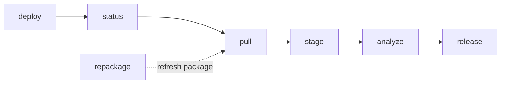

# ird — RTL Test Runner

## 1. What this tool does

`ird` drives the end-to-end flow for RTL simulation test runs on Tenstorrent
IRD compute containers. It reserves a remote machine, ships a self-contained
worker, runs the test suite in the background, packages the results, pulls the
package back locally, and feeds it into
`polaris_big/tools/run_rtl_neosim_correlation.py` for model-vs-RTL correlation
and S-curve generation.

Every stage is exposed as its own CLI subcommand so you can recover gracefully
after a network glitch, iterate on analysis without re-simulating, or rebuild
the data package without re-running tests. A single convenience command
(`ird.cli run`) wires them all together for the common case.

## 2. Pipeline at a glance



| Command     | One-liner                                                                |
| ----------- | ------------------------------------------------------------------------ |
| `deploy`    | Reserve an IRD instance, ship `remote_worker/`, launch tests detached.   |
| `status`    | Poll remote progress; with `--watch` blocks until all tests finish.      |
| `pull`      | Rsync `data_package/` from the remote into `<local-dir>/<rtl_tag>/`.     |
| `repackage` | Rebuild `data_package/` on the remote without re-running tests.          |
| `stage`     | Copy pulled `ws-tensix/{src,rsim}` into `polaris_big/__ext/...`.         |
| `analyze`   | Stage + run `polaris_big/tools/run_rtl_neosim_correlation.py`.           |
| `release`   | Release the IRD reservation.                                             |
| `run`       | Convenience chain: deploy → status → pull → analyze → release.           |

`repackage` is the escape hatch for "tests are already done, I just want a fresh
data package" — it's dotted because it re-enters the pipeline upstream of `pull`
without going through `deploy`/`status`.

## 3. Quickstart (manual, step-by-step)

The minimal command sequence for a fresh end-to-end run, broken into separate
stages so you can recover gracefully if any one step fails:

```bash
python -m ird.cli deploy   --config ird/run_config_example.json
python -m ird.cli status   --watch
python -m ird.cli pull
python -m ird.cli analyze  --config ird/run_config_example.json
python -m ird.cli release
```

## 4. One-shot: `ird.cli run`

For the common case — fresh tag, no prior state, you want everything done —
`run` chains the five stages above into a single command. See
[commands/run.py](commands/run.py).

```bash
python -m ird.cli run --config ird/run_config_example.json
```

What it does, in order:

1. `deploy` — reserve an IRD instance, ship `remote_worker/`, launch tests
   detached, write `session.json`.
2. `status --watch` — poll the remote until all tests have finished (success or
   failure).
3. `pull` — rsync `data_package/` from the remote to `<local-dir>/<rtl_tag>/`.
4. `analyze` — stage the pulled tree into
   `polaris_big/__ext/rtl_test_data_set/<rtl_tag>/{src,rsim}` and invoke
   `polaris_big/tools/run_rtl_neosim_correlation.py`.
5. `release` — release the IRD reservation. Wrapped in a `try/finally`, so the
   IRD job is released even if any earlier stage raised.

Common options:

- `--config <path>` (required) — the same `run_config.json` consumed by every
  individual stage.
- `--local-dir <path>` (default `.`) — passed through to `pull`; the pulled
  tree lands at `<local-dir>/<rtl_tag>/`.
- `--session <path>` (default `session.json`) — shared state file for
  deploy/status/pull.

When **not** to use `run`:

- Tests are already done and you only want to refresh the data package or
  re-run analysis. Use the targeted commands instead — see
  [Workflows](#8-workflows--recipes). `run` will re-reserve, re-deploy, and
  re-execute every test in the suite.
- A previous attempt failed mid-pipeline. Inspect `session.json`, then continue
  with the specific stage you need (e.g. `pull`, `analyze`) — `run` always
  starts from `deploy` and creates a new reservation.

## 5. Configuration: `run_config.json`

All commands read a single JSON file (see
[run_config_example.json](run_config_example.json)) with two top-level
sections: `rtl` (maps to `RTLConfig`) and `model` (maps to `ModelConfig`).

```json
{
  "rtl": {
    "tensix_host": "tensix-l-12",
    "rtl_tag": "apr16",
    "remote_root_dir_path": "/proj_tensix/user_dev/sjaju/work/apr/16",
    "remote_root_dir": "ws-tensix",
    "git_url": "git@yyz-gitlab.local.tenstorrent.com:tensix/tensix-hw/ws-tensix.git",
    "suites": "postcommit",
    "yaml_files": {
      "ttx-llk-sfpu.yml":  {"suites": "postcommit"},
      "ttx-llk-fixed.yml": {"suites": "postcommit"}
    },
    "mode": "batch",
    "num_processes": 11,
    "max_test_attempts": 2,
    "launch_mode": "direct_ssh",
    "remote_python": "/opt/miniconda3/bin/python",
    "package_level": "minimal"
  },
  "model": {
    "git_url": "git@github.com:tenstorrent/polaris_big.git",
    "git_branch": "main",
    "num_processes": 11
  }
}
```

Most-tweaked fields, grouped by purpose:

- **IRD reservation**: `tensix_host` (pin a healthy machine — see
  [Troubleshooting](#10-troubleshooting)), `ird_server` (default `yyz-ird`),
  `ird_cluster` (default `tt_aus`), `ird_team` (default `tensix_interactive`).
- **Test selection**: `rtl_tag`, `suites`, `yaml_files`, `tests`.
- **Execution**: `mode` (`batch` or `serial`), `num_processes`,
  `max_test_attempts`, `launch_mode` (`ird_connect` or `direct_ssh`),
  `remote_python`.
- **Packaging**: `package_level` (`minimal` or `comprehensive`, see
  [Package levels](#9-package-levels-minimal-vs-comprehensive)).
- **polaris_big patches**: `previous_rtl_tag` — anchor + source for the
  per-tag patches applied to the polaris_big checkout (default `"feb20"`).
- **Remote checkout**: `remote_root_dir_path`, `remote_root_dir`, `git_url`.

Full field list lives in [config.py](config.py).

## 6. Commands reference

All subcommands are invoked via `python -m ird.cli <subcommand> [options]`.
Values shown are defaults.

### `deploy`

```
python -m ird.cli deploy --config <path> [--session session.json]
```

Reserves an IRD instance, syncs `remote_worker/` and `job_config.json`, launches
the worker detached, and writes `session.json`. **Cleans up stale artifacts**
(`progress/`, `DONE`, `data_package/`, `job.log`) on the remote work directory
before launching, and then re-runs every test in the suite — there is no
incremental skip. If tests are already done and you only want to refresh the
data package, use `repackage` instead.

### `status`

```
python -m ird.cli status [--watch] [--interval 30] [--config <path>]
```

Reads `session.json`, SSHs to the remote, and reports how many tests have
finished. `--watch` polls every `--interval` seconds until the worker writes
`DONE`. `--config` optionally overrides reservation-related session fields
(useful if `session.json` is stale — the command will refresh or re-reserve as
needed). **If `session.json` is missing** and `--config` is given, the command
bootstraps one: adopts your existing live IRD reservation (filtered by
`tensix_host` if set), or reserves a new one.

### `pull`

```
python -m ird.cli pull [--local-dir .] [--config <path>]
```

Rsyncs the remote `data_package/` into `<local-dir>/<rtl_tag>/`. Moves any
pre-existing `<local-dir>/<rtl_tag>/` aside to `<local-dir>/<rtl_tag>.bak`
first so the pull always starts clean. Supports the same `--config` refresh
and missing-`session.json` bootstrap behavior as `status`.

### `repackage`

```
python -m ird.cli repackage [--config <path>]
```

Re-runs only the data-packaging phase on the remote — no test re-execution.
Syncs the latest `remote_worker/` (so packager fixes apply), ensures
`remote_worker/vendor/` is installed, patches `job_config.json` with any updated
`package_level` / `num_bytes_per_register` from `--config`, and invokes
`remote_worker.data_packager.package`. Acquires a temporary IRD reservation if
one is not already alive, and releases it afterwards. Pair with `pull` to get
the refreshed package locally. Bootstraps `session.json` from `--config` if it
doesn't exist (same behavior as `pull` / `status`).

### `stage`

```
python -m ird.cli stage --config <path> [--data-dir .] [--polaris-big-dir polaris_big] [--method copy]
```

Copies pulled `ws-tensix/{src,rsim}` into
`polaris_big/__ext/rtl_test_data_set/<rtl_tag>/{src,rsim}`, filtering out
comprehensive-only debug artifacts (`TOP*.txt`, `sim-run.log`,
`*.rtl_test.log`) so the staged tree is always minimal and tar-ready. Pass
`--method symlink` for a fast dev shortcut (absolute symlinks; do NOT tar
the result). If `<polaris_big_dir>` doesn't exist, it's auto-cloned from
`model.git_url` on `model.git_branch`; an existing checkout is used as-is
(no pull). Right after cloning, the polaris_big checkout is patched
(idempotently) to teach it about `rtl.rtl_tag` — see
[Polaris patches](#polaris-big-patches) below.

### `analyze`

```
python -m ird.cli analyze --config <path> [--data-dir .] [--polaris-big-dir polaris_big] [--stage-method copy]
```

Stages the pulled data (same as `stage`) and then invokes, from within
`<polaris_big_dir>/`:

```
python tools/run_rtl_neosim_correlation.py \
    --tag <rtl_tag> \
    --parallel <num_processes> \
    --memoryMap __ext/rtl_test_data_set/<rtl_tag>/src/meta/instructions/yaml/memory_map.json \
    --cfg config/tensix_neo/ttqs_neo4_<rtl_tag>.json
```

Produces the correlation CSV, S-curve PNG, and per-test model logs that the
polaris_big tool writes into its output directories. Same auto-clone
behaviour for `<polaris_big_dir>` as `stage`: cloned from `model.git_url`
on `model.git_branch` if missing, untouched if present. Also applies the
same idempotent polaris_big patches — see
[Polaris patches](#polaris-big-patches) below.

<a id="polaris-big-patches"></a>

#### polaris_big patches (auto-applied by `stage` / `analyze`)

Upstream `polaris_big/main` hard-codes the list of accepted RTL tags in four
places, and ships a per-tag JSON config. A fresh tag (e.g. `apr16`) needs all
four additions before `run_rtl_neosim_correlation.py` will accept it. The
patcher (`ird/local/polaris_big_patch.py`) applies them idempotently every
time `stage` / `analyze` runs:

1. `tools/run_rtl_neosim_correlation.py` — append `rtl_tag` to
   `self.rtl_tags: list[str] = [...]`.
2. `ttsim/back/tensix_neo/tensixFunc.py` — append `rtl_tag` to the
   `assert args['llkVersionTag'] in [...]` list.
3. `ttsim/back/tensix_neo/isaFunctions.py` — insert `rtl_tag = "<rtl_tag>" #
   <pretty date>` into `class TTQSTags`, right after `rtl.previous_rtl_tag`.
4. `config/tensix_neo/ttqs_neo4_<rtl_tag>.json` — seeded by copying
   `ttqs_neo4_<previous_rtl_tag>.json`.

`rtl.previous_rtl_tag` (default `"feb20"`) is the anchor for step 3 and the
source for step 4. Bump it when a new upstream tag lands.

### `release`

```
python -m ird.cli release [--config <path>]
```

Releases the IRD reservation identified by `session.json`. Safe to re-run; noop
if already released. If `session.json` is missing, pass `--config` to locate
and release your active reservation (discovered via `ird list`).

### `run`

See [section 4](#4-one-shot-irdcli-run) above.

## 7. On-disk layout

### Remote work directory — `<remote_root_dir_path>/_rtl_job/`

```
_rtl_job/
  remote_worker/          # shipped by deploy: setup, test_runner, data_packager, vendor/
  job_config.json         # flattened RTLConfig consumed by the worker
  job.log                 # worker stdout/stderr (nohup)
  progress/<test>.json    # per-test status written by test_runner
  DONE                    # marker file; appears when all tests have finished
  data_package/           # built by data_packager; rsynced back by pull
```

### Pulled local tree — `<local-dir>/<rtl_tag>/`

Contents of the remote `data_package/` verbatim:

```
<rtl_tag>/
  ws-tensix/
    src/meta/instructions/yaml/{assembly.yaml,memory_map.json}
    rsim/debug/<test>_0/{sim_result.yml,*.elf, ...}
    # comprehensive adds: src/firmware, src/hardware/tensix/proj,
    #                     src/meta, src/verif, sim-run.log, TOP*.txt,
    #                     <test>.rtl_test.log
  git_commit_id.txt
  job_config.json
```

### Staged consumer tree — `polaris_big/__ext/rtl_test_data_set/<rtl_tag>/`

Always minimal, regardless of pull level — ready to `tar -czf` and upload to
the shared file-cache server:

```
<rtl_tag>/
  src/meta/instructions/yaml/{assembly.yaml,memory_map.json}
  rsim/debug/<test>_0/{sim_result.yml,*.elf}
```

## 8. Workflows / recipes

### Fresh run (everything from scratch)

```bash
python -m ird.cli run --config ird/run_config_example.json
```

Or the manual sequence in [Quickstart](#3-quickstart-manual-step-by-step) if you
want checkpoints.

### Iterate on analysis only (tests already done)

```bash
python -m ird.cli repackage --config ird/run_config_example.json
python -m ird.cli pull      --config ird/run_config_example.json
python -m ird.cli analyze   --config ird/run_config_example.json
```

Why: `repackage` rebuilds `data_package/` without touching the expensive sim
runs; `pull` refreshes your local copy; `analyze` re-stages and re-runs the
polaris_big correlation tool.

### Iterate on packager logic only

```bash
python -m ird.cli repackage --config ird/run_config_example.json
```

Why: after editing `ird/remote_worker/data_packager.py`, `repackage` re-syncs
the package to the remote and reruns only the packaging step. The worker is
not re-launched and tests are not re-executed.

## 9. Package levels (minimal vs comprehensive)

Set `rtl.package_level` in `run_config.json`.

| Artifact                                              | minimal | comprehensive |
| ----------------------------------------------------- | :-----: | :-----------: |
| `git_commit_id.txt` + `ws-tensix/rtl_git_commit_id.txt` |   yes   |      yes      |
| `ws-tensix/src/meta/instructions/yaml/assembly.yaml`   |   yes   |      yes      |
| `ws-tensix/src/meta/instructions/yaml/memory_map.json` (generated) |   yes   |      yes      |
| Per-test `sim_result.yml` + `*.elf`                    |   yes   |      yes      |
| `ws-tensix/src/firmware`, `src/hardware/tensix/proj`   |    -    |      yes      |
| `ws-tensix/src/meta`, `src/verif` (full trees)         |    -    |      yes      |
| Per-test `sim-run.log`, `TOP*.txt`, `*.rtl_test.log`   |    -    |      yes      |

Notes:

- `memory_map.json` is always generated on the remote (needs `beautifulsoup4`,
  which is auto-installed into `remote_worker/vendor/`).
- `ws-tensix/infra/` is no longer packaged at any level — consumers did not
  need it.
- `stage` / `analyze` always produce a minimal tree in
  `polaris_big/__ext/...`, filtering comprehensive-only artifacts regardless of
  how you pulled.

## 10. Troubleshooting

- **`(null)` SSH port** from `ird list` for your assigned machine — that
  compute node is sick. Pin a healthy host via `rtl.tensix_host` in
  `run_config.json` (e.g. `"tensix_host": "tensix-l-12"`) and redeploy.
- **`Connection refused` or expired reservation mid-pipeline** — `session.json`
  is stale. Rerun any standalone command with `--config <path>`; the
  `ensure_reservation` helper will refresh `selection_id` if the job is still
  alive, or reserve a new instance (pinned to `tensix_host`) and update the
  session.
- **`bs4` import errors on remote during `repackage`** — the vendor dir is
  missing or broken. `ird repackage` runs `_install_vendor_deps` on every
  invocation, which probes `import bs4` and reinstalls into
  `remote_worker/vendor/` if the probe fails. No shared conda env is modified.
- **`AssertionError: Multiple cfg_defines.h files found with different
  contents`** from memory-map generation — fixed by scoping the walk to
  `ws-tensix/src/` (not the whole `ws-tensix/` tree). If you add new
  `deps/.../cfg_defines.h` copies this may resurface; narrow the walk further
  in `data_packager._package_memory_map`.
- **`SyntaxError: future feature annotations is not defined`** on the remote —
  the worker fell back to `/usr/bin/python` (3.6). Make sure
  `rtl.remote_python` in `run_config.json` points at the conda Python (e.g.
  `/opt/miniconda3/bin/python`) and `rtl.launch_mode` is `ird_connect`, which
  sources the container environment (`IRD_VERSION`, conda, `tek` env).
- **`polaris_big/` on wrong branch or stale** — the tool clones `polaris_big/`
  only when the directory is missing; it never auto-updates a present
  checkout. If you need a different branch or the latest `main`, fix it
  manually (`git -C polaris_big fetch && git -C polaris_big checkout <branch>`)
  or remove the directory and rerun `stage` / `analyze` to re-clone.
- **`ValueError: One or more invalid RTL tag(s)`** from
  `run_rtl_neosim_correlation.py` — the patcher couldn't find the expected
  anchor. Verify `rtl.previous_rtl_tag` matches an existing tag in upstream
  polaris_big's `TTQSTags` enum and that `config/tensix_neo/ttqs_neo4_<prev>.json`
  exists. If upstream renamed the enum or the assert, update
  `ird/local/polaris_big_patch.py` regexes.
- **`session.json` deleted / new shell with no state** — don't run `deploy`
  (that would re-run tests). Rerun any of `repackage` / `pull` / `status` /
  `release` with `--config <run_config.json>`; the command will adopt your
  existing IRD reservation (pinned to `tensix_host` if set) and rewrite
  `session.json`. Without `--config` you'll get a clear error telling you to
  pass it.
- **Pulled tree missing `memory_map.json`** — check with a quoted glob:
  `find ./ -name '*.json'` (unquoted, `*.json` is expanded by your shell
  before `find` sees it). The packager always writes this file at
  `ws-tensix/src/meta/instructions/yaml/memory_map.json`.

## 11. Project layout

```
ird/
  cli.py                     # python -m ird.cli <subcommand>
  commands/                  # deploy, status, pull, repackage, stage, analyze, release, run
  remote/deployer.py         # ships remote_worker, launches detached
  remote_worker/             # runs on the IRD compute container
    setup.py, test_discovery.py, test_runner.py, data_packager.py,
    registers_utils.py, vendor/
  local/stage.py             # local: stage pulled data into polaris_big/__ext
  local/polaris_big.py       # local: auto-clone polaris_big/ if missing
  local/polaris_big_patch.py # local: per-rtl_tag patches for polaris_big
  transfer/                  # resilient ssh + rsync
  ird_reservation.py         # ird reserve / list / release
  session.py                 # session.json schema + helpers
  config.py                  # RTLConfig + ModelConfig dataclasses
  connection.py              # ensure_reservation, apply_config_overrides,
                             # load_or_bootstrap_session, bootstrap_session_from_config
  run_config_example.json
  validate_local.py          # offline self-check (python -m ird.validate_local)
  README.md                  # this file
```

The legacy pre-refactor architecture is documented in
[../CODEBASE_ANALYSIS.md](../CODEBASE_ANALYSIS.md) — kept as historical context
only.
